# Metal Gear Solid (PS1) — spolszczenie

Nieoficjalne, fanowskie spolszczenie **Metal Gear Solid** (PlayStation, 1998) w postaci łatek na obie płyty. Do nałożenia łatek potrzebny jest program **[Delta Patcher](https://github.com/marco-calautti/DeltaPatcher/releases)** (Windows, macOS, Linux).

Po polsku są Codec, cutscenki, filmy, menu, ekwipunek, opisy przedmiotów, grafiki interfejsu i napisy końcowe. Głosy zostają angielskie.

## Zrzuty ekranu

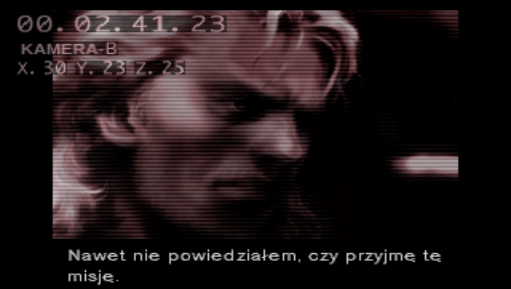
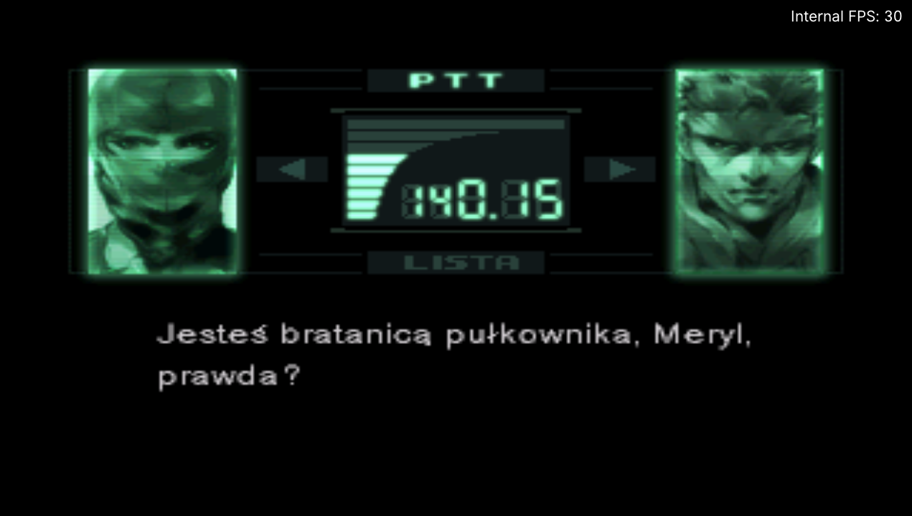
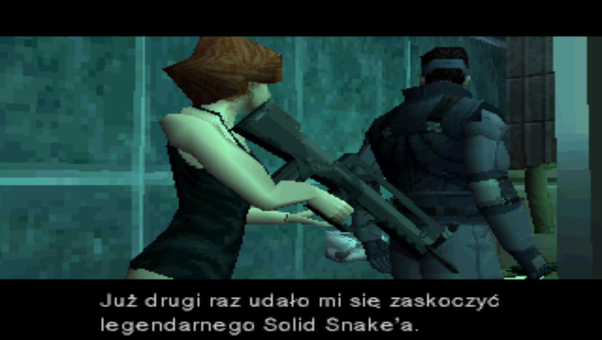
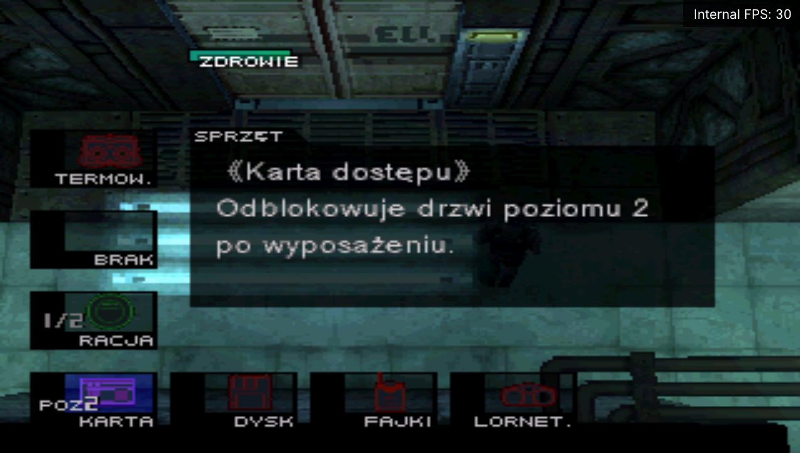
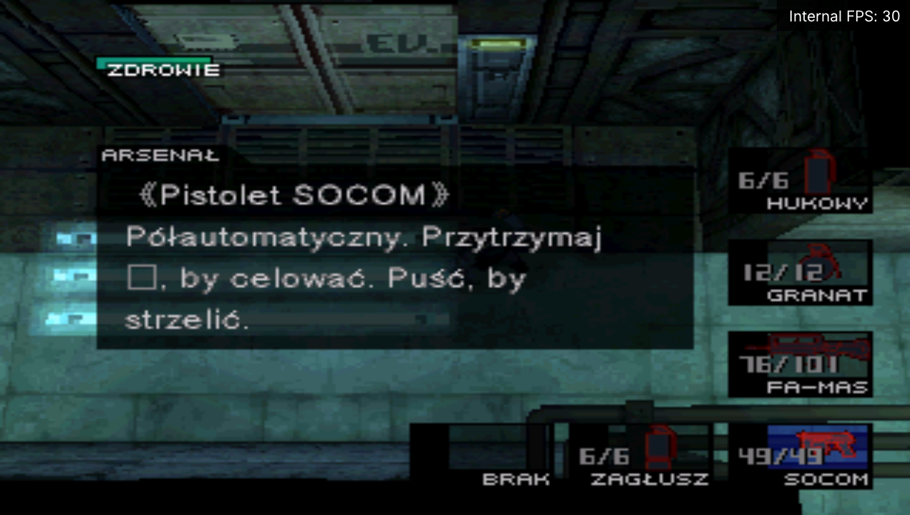
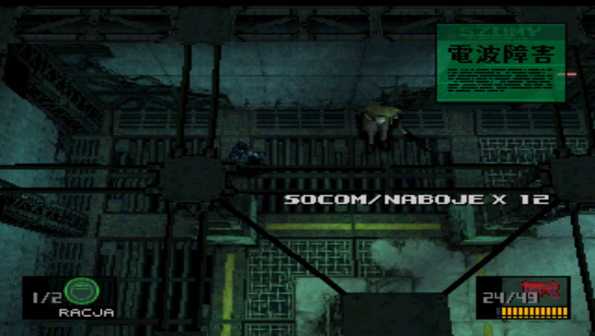
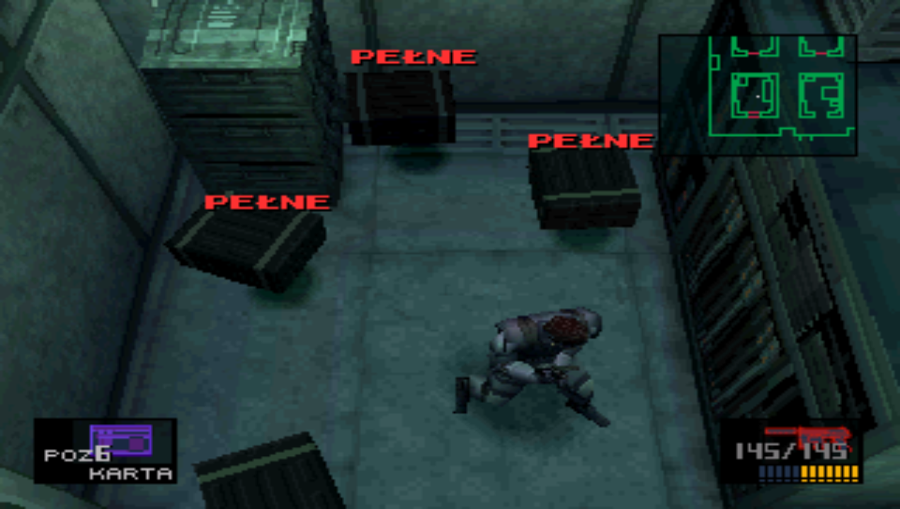
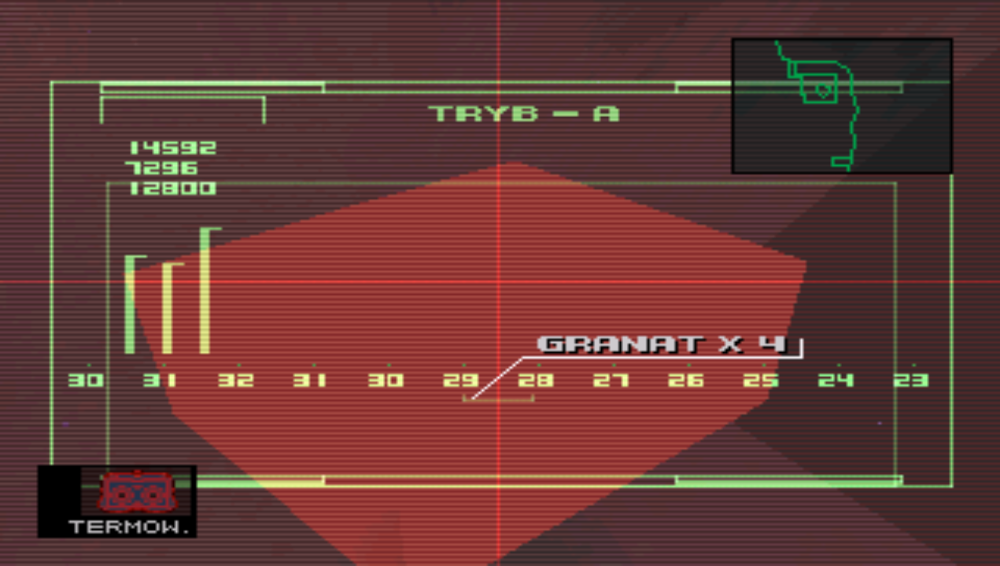
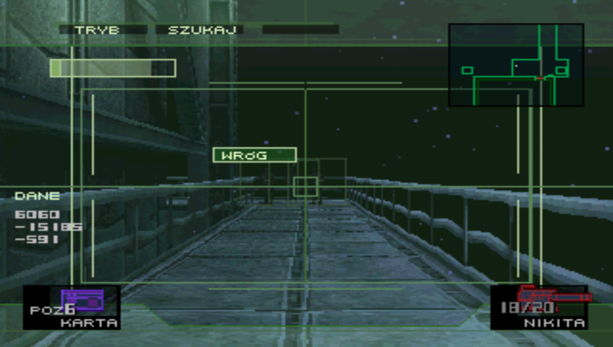
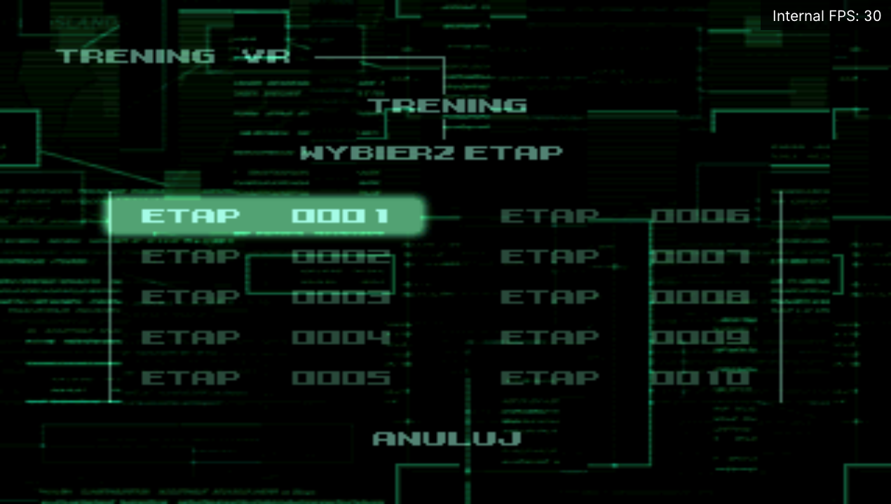
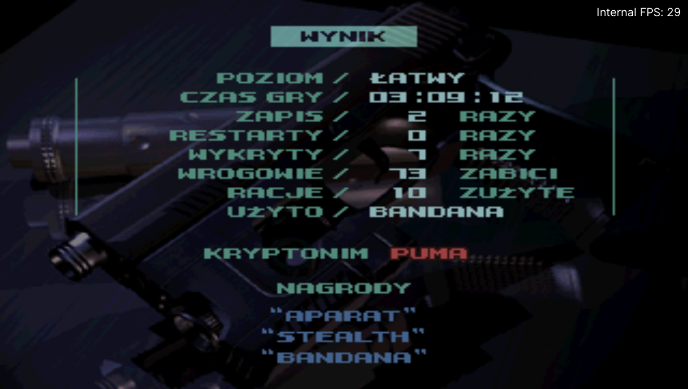

## Czego potrzebujesz

Własnej kopii gry w wersji amerykańskiej **NTSC-U, Rev 1** (wydanie Greatest Hits / Essential Collection), jako BIN/CUE:
- płyta 1: `SLUS-00594`,
- płyta 2: `SLUS-00776`.

Łatki pobierzesz z zakładki **Releases**.

## Instalacja

1. Skopiuj pliki BIN i CUE obu płyt do osobnego folderu, bo Delta Patcher nadpisuje plik, na który nakłada łatkę.
2. Uruchom Delta Patcher.
3. W polu **Original file** wskaż skopiowany BIN płyty 1.
4. W polu **XDelta patch** wskaż `MGS1_PL_v1.0_d1.xdelta`.
5. Kliknij **Apply patch**.
6. Powtórz kroki 3–5 dla płyty 2 z łatką `MGS1_PL_v1.0_d2.xdelta`.

Łatka działa tylko na wersji Rev 1. Na wersji PAL, pierwszym wydaniu (Rev 0) albo uszkodzonym zrzucie zgłosi błąd.

Projekt fanowski i niekomercyjny, niezwiązany z Konami. *Metal Gear Solid* jest znakiem towarowym Konami Digital Entertainment. Repozytorium nie zawiera danych gry.
